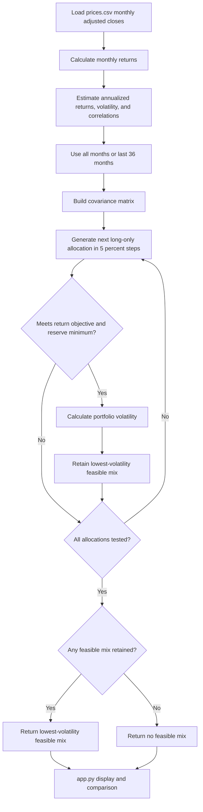

# Lab 15 - Portfolio Stability Decision

## Question

Which mix carries the least risk while meeting the mandate, and does the answer survive a one-point change?

The app searches every long-only allocation in 5-percentage-point increments. It keeps only allocations that meet the tested return objective and reserve minimum, then selects the feasible allocation with the lowest volatility.

## Meridian training verification

The following results were recomputed with [portfolio.py](portfolio.py), not entered as answers.

| Case | Bills / 10-year / IG / equity | Expected return | Volatility | Reserve-eligible |
|---|---|---:|---:|---:|
| Base | 0% / 20% / 25% / 55% | 6.51% | 9.44% | 20% |
| Equity estimate reduced from 8% to 7% | 0% / 10% / 10% / 80% | 6.53% | 12.94% | 10% |
| IG-equity correlation raised from 0.25 to 0.50 | 0% / 40% / 0% / 60% | 6.52% | 9.73% | 40% |

The equity-return change moved the largest sleeve by 25 percentage points. For the correlation case, the two symmetric correlation entries were changed only in memory for the test; [portfolio.py](portfolio.py) remains at 0.25 in both cells.

## Project 2 data and tested assumptions

The Project 2 universe is BIL, IEF, AGG, and ACWI. [prices.csv](prices.csv) contains 60 monthly adjusted-close observations from October 2021 through September 2026, downloaded October 22, 2026. This creates 59 monthly returns. The ticker-level source, download date, and date range are recorded in [Project-2-Data-Sources.md](Project-2-Data-Sources.md); the source record is complete for all four tickers.

Historical average returns in this report are estimates, not forecasts.

The test uses a 6.5% expected-return objective, a 3% reserve minimum, and BIL plus IEF as reserve-eligible. I checked [mandate.py](mandate.py): it is the Meridian Foundation training checker and does not provide a separate personal Project 2 mandate. Therefore, these are Meridian-style test assumptions, not a verified final Project 2 mandate. `python3 mandate.py` was run separately; it confirmed the Meridian candidate results, including Candidate E's reserve-rule failure.

## Project 2 results under the tested assumptions

| Historical window | BIL / IEF / AGG / ACWI | Expected return | Volatility | Reserve-eligible |
|---|---|---:|---:|---:|
| All 59 monthly returns | 60% / 0% / 0% / 40% | 6.69% | 6.03% | 60% |
| Last 36 monthly returns | 85% / 0% / 0% / 15% | 6.79% | 1.77% | 85% |

The largest allocation change between the two historical windows is 25 percentage points.

## AI-assisted practice partner challenge

For the last-36-month case, ACWI's estimated annual return was reduced from 20.50% to 19.50%. Every other estimated input and every tested constraint remained unchanged.

| Case | BIL / IEF / AGG / ACWI | Expected return | Volatility | Reserve-eligible |
|---|---|---:|---:|---:|
| Original last-36-month estimate | 85% / 0% / 0% / 15% | 6.79% | 1.77% | 85% |
| ACWI estimate reduced by one point | 85% / 0% / 0% / 15% | 6.64% | 1.77% | 85% |

The largest allocation change is 0 percentage points. The mix survives this specific ACWI stress because the 5-point search selects the same allocation, but the 25-point difference between historical windows still shows meaningful estimation risk. This was an AI-assisted practice partner challenge, not an in-person partner interaction.

## Reflections

**What is estimation risk?** It is the risk that the return, volatility, or correlation inputs estimated from limited historical data do not represent the future.

**Why can small expected-return errors create large allocation changes?** The search chooses only from 5-point weight increments and must clear a return threshold. A small change can make a different mix become the lowest-risk feasible option.

**Why did the mix change between the 59-month and 36-month estimates?** The shorter window contained a different market history, producing different estimated returns, volatilities, and correlations. In particular, the estimated ACWI return and the low-volatility BIL return changed enough to alter the feasible low-risk mix.

**What evidence would I need before adopting the allocation?** I would verify the actual Project 2 mandate, validate the price data and fund eligibility, test more reasonable historical windows and assumptions, and review whether the result remains stable under those checks.

**How does the 25-point window change contrast with the 0-point ACWI stress?** The ACWI one-point stress did not cross a decision boundary for this discrete search, so the weights stayed the same. Changing the historical window changed several estimated inputs at once and produced a 25-point allocation shift, which is stronger evidence of estimation sensitivity.

## Decision: PILOT, not adopt

Both historical windows meet the tested constraints, and the one-point ACWI stress is stable. However, the 25-point shift between historical windows makes the allocation too sensitive to estimation choices to adopt immediately. I would consider adoption only after verifying the actual mandate and showing acceptable stability across additional reasonable assumptions and periods.

## Engine and app workflow

The Streamlit page in [app.py](app.py) imports and reuses [portfolio.py](portfolio.py). Its last-36-month switch calls the CSV estimator with the selected period, and its all-month baseline uses the same objective, reserve minimum, and reserve-eligibility selections as the edited scenario.

## Verification and remaining manual requirements

Verified automatically:

- All three Meridian cases above.
- Both CSV historical windows and the ACWI one-point stress.
- The 36-month estimates differ from the all-month return, volatility, and correlation estimates.
- `python3 portfolio.py` preserved the Lab 14 known-answer output.
- Python syntax checks passed for [portfolio.py](portfolio.py), [mandate.py](mandate.py), and [app.py](app.py).

Not automatically verifiable or complete from the repository:

- An in-person partner explanation, partner attack, or quiz attempt.
- A confirmed personal Project 2 mandate.
- Individual Brightspace submission.
- Repository commit and push: this working directory has no `.git` directory or configured remote, so no commit, push, or GitHub URL can be verified here.
